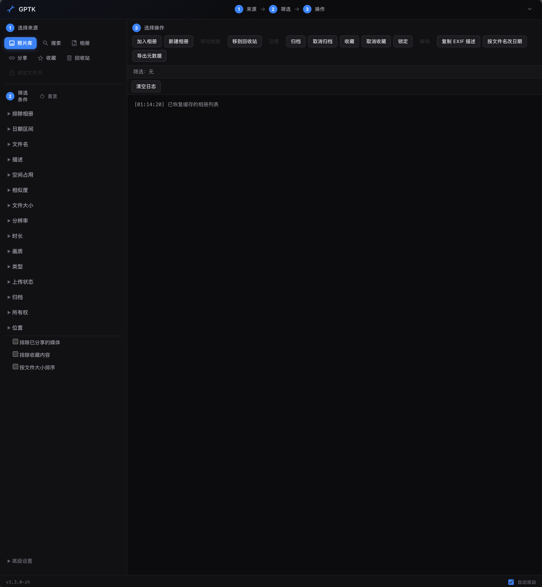

# Google Photos Toolkit（简体中文版）

> **本仓库为第三方汉化分支**，基于 [xob0t/Google-Photos-Toolkit](https://github.com/xob0t/Google-Photos-Toolkit)（MIT）。仅翻译界面文案，逻辑未改。汉化详情与上游同步方式见 [LOCALIZATION.md](./LOCALIZATION.md)。

批量整理你的媒体文件 —— 本仓库是 [xob0t/Google-Photos-Toolkit](https://github.com/xob0t/Google-Photos-Toolkit) 的中文界面汉化版，仅翻译界面文案与运行时提示，逻辑与 API 调用完全保持原样。



<sub>截图来源：本仓库 v3.3.0-zh。上游英文版界面见 [demo-en.png](media/demo-en.png)。</sub>

## 工作原理

在浏览器内运行，利用 Google 相册未公开的 Web API。

## 安装方法

1. 为浏览器安装 [Tampermonkey](https://www.tampermonkey.net/) 用户脚本管理器
   - 如果在 Android 上，推荐 [Firefox](https://www.mozilla.org/firefox/browsers/mobile/android/)，它支持 Tampermonkey
2. 打开本仓库的构建产物 `google_photos_toolkit.user.js`（或点击 [Install](https://github.com/xob0t/Google-Photos-Toolkit/releases/latest/download/google_photos_toolkit.user.js) 安装原版英文脚本）
3. 确认安装

### 找出占用空间的媒体

把占空间的媒体归到一个相册里：

1. 确认来源选中的是「照片库」
2. 在「空间占用」筛选器中选择「占用空间」
3. 选择操作「新建相册」

### 找出不属于任何相册的媒体

在「排除相册」筛选器里全选所有相册，然后执行相应操作。

### 找出重复/相似图片

用「相似度」筛选器 + 操作「新建相册」，缩略图相似的媒体会被加入该相册。

### 清空照片库

来源选「照片库」，点「移到回收站」，再清空回收站即可。

### 使用 GPTK 的 API

GPTK 会把 API 类挂到全局，可以在浏览器控制台里直接调用，比 UI 强大得多。

示例：扫描整个照片库，把归属于 `ownerName` 的媒体移入回收站。

```js
let nextPageId = null;
const ownerName = 'John';
do {
  const page = await gptkApi.getItemsByUploadedDate(nextPageId);
  for (const item of page.items) {
    if (item.isOwned) continue;
    const itemInfo = await gptkApi.getItemInfoExt(item.mediaKey);
    console.log(`${item.mediaKey} is shared by ${itemInfo.owner.name}`);
    if (itemInfo.owner.name == ownerName) {
      await gptkApi.moveItemsToTrash([itemInfo.dedupKey]);
      console.log(`${item.mediaKey} moved to trash`);
    }
  }
  nextPageId = page.nextPageId;
} while (nextPageId);
console.log('DONE');
```

## 本地构建

```bash
npm install
npm run build      # 产出 google_photos_toolkit.user.js
npm test           # 单元测试
npm run typecheck  # 类型检查
```

## 贡献

想了解 GP 的 API 原理，可以读这篇 [Deciphering Google batchexecute](https://kovatch.medium.com/deciphering-google-batchexecute-74991e4e446c)。

## 问题反馈

功能异常请到原仓库提 [issue](https://github.com/xob0t/Google-Photos-Toolkit/issues)，疑问请开 [discussion](https://github.com/xob0t/Google-Photos-Toolkit/discussions)。

## 致谢

代码与 UI 灵感来自 [undiscord](https://github.com/victornpb/undiscord)。

## ♥

如果 GPTK 对你有帮助，欢迎支持原作者：

BTC `12znTocLytrrYhQT4AJVeJdR8KTULWbKb7`
BTC Cash `qq7w48d6s3rddgxshl6ae48k7c5jyck76crvppqenn`
DOGE `DQjBzT2qMuXkLMawUXG7umTf3k9VeT4Y6K`
Etherium `0xcfe559D9F6056F82a6CFdEDA51c00132035955c8`
Litecoin `ltc1qcgc873py5k28qm85sk5d53yfwzle4cztmvkh6l`
